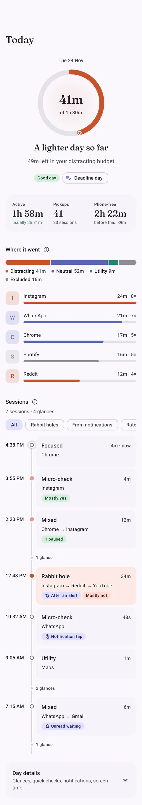
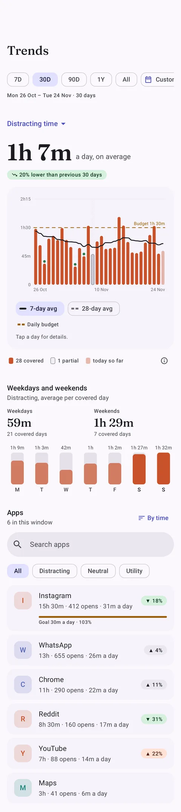
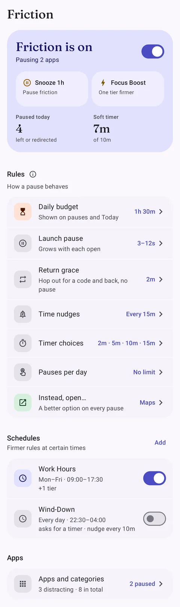
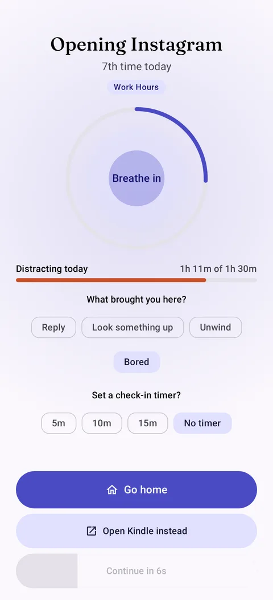
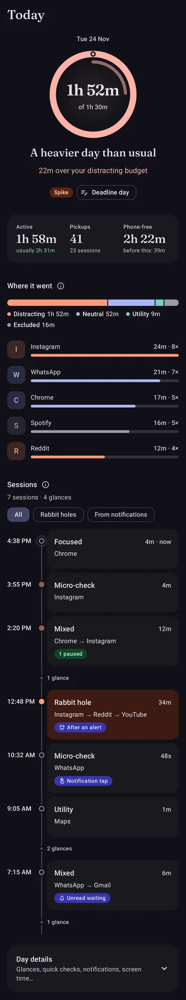
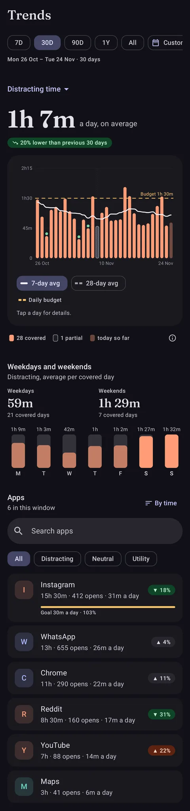
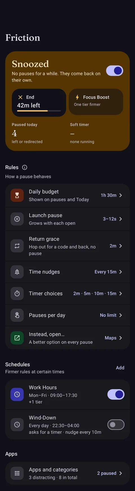
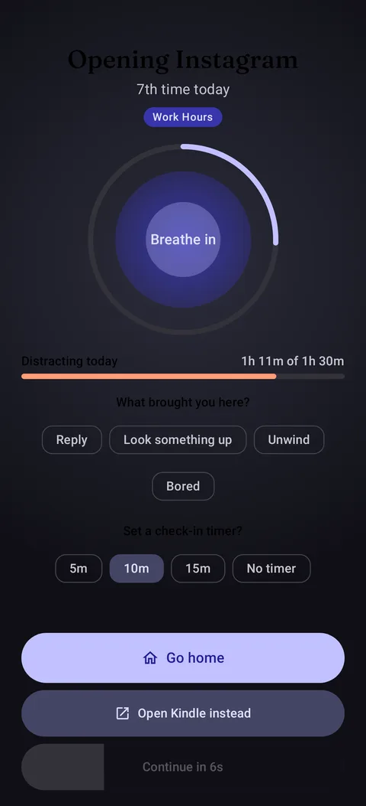

# Orbit — the Lagrange design system

Lagrange is an instrument for looking at your own behaviour. It should feel like a well-made one: calm, precise,
honest about what it doesn't know, and with a little warmth so it never feels like surveillance. *Orbit* is the
system that makes every screen feel that way. It is Material 3 underneath, with three things on top: a voice
(Fraunces), fixed meaning colours, and motion treated as part of the design rather than decoration.

Code lives in `ui/theme` (tokens) and `ui/components` (building blocks). Screens use only these; a raw `dp`, colour
or animation spec in a screen is a smell.

## Screens

Rendered from fixtures by the screenshot tests (light and dark).

| Today | Trends | Friction | Launch pause |
| --- | --- | --- | --- |
|  |  |  |  |
|  |  |  |  |

Component specimen: [light](design-system/design-system-light.webp) · [dark](design-system/design-system-dark.webp)

## 1. What was wrong, and the rule that fixes it

| Problem in the old UI | Rule |
| --- | --- |
| ~40 identical cards (eyebrow + icon badge + title), so nothing stood out. | **One hero per screen**, then flat sections separated by space. A container (`Panel`) only for a distinct object or something you act on. |
| Every screen opened with ~200dp of marketing copy ("Gentle by design", "Under the hood"). | Titles are plain nouns ("Today"). What the screen *says* is its hero: a number and one sentence. |
| Caveat paragraphs inline everywhere, at the same weight as data. | Honesty stays, out of the way: caveats live behind an ⓘ (`Info` → `InfoSheet`). Only a caveat that changes the reading of a number (a coverage gap) is shown inline, as a `Banner`. |
| Amber meant "distracting", "rabbit hole", "7-day average", "star rating" and "Focus Boost" at once; with wallpaper colours on, categories became random hues. | **One hue, one meaning**, and meaning colours never follow the wallpaper. |
| Walls of stat tiles (9 on Today) and chip rows (4 category chips per app × 100 apps). | Show the 3 numbers that answer the question; fold the rest away (`Day details`). Long lists use one compact control per row (a category menu, a switch). |
| Five tabs mixing daily use and settings. | Four tabs for the four questions; housekeeping behind a gear. |
| Motion bolted on: one 900ms tween, a crossfade, ad-hoc durations. | Motion tokens and patterns used by every component (section 5). |

## 2. Information architecture

| Destination | Question it answers | Hero |
| --- | --- | --- |
| **Today** | How am I doing today? | Distracting time against budget, drawn as an orbit |
| **Trends** | Am I improving? | Daily average for the chosen metric + change vs the previous period |
| **Lab** | Why does it happen? | Each tab's own question as its heading |
| **Friction** | What do I do about it? | The current mode (off / on / snoozed / boost) |
| Settings (gear) | Is it working? Where is my data? | One-line health summary |

Drill-ins (an app's deep dive, the Apps list, the timeline inspector) slide in on the shared X axis and support the
predictive back gesture (`DrillIn`). Editing anything opens a bottom sheet (`EditSheet`), so you never leave the
screen you were reading. The gear shows a dot when something in Settings needs attention.

## 3. Colour

Two families, never mixed:

- **Brand & interaction** — the Material `ColorScheme` ("Night" indigo primary, "Starlight" gold tertiary). Buttons,
  selection, focus. These follow the wallpaper when *Wallpaper colours* is on.
- **Meaning** — `Lagrange.colors` (`Semantic`). Fixed hues, light and dark variants, never dynamic.

| Token | Means | Used for |
| --- | --- | --- |
| `category.distracting` / `ember` | Distracting time and what grows it | Distracting bars, budget gauge, rabbit holes, spikes |
| `category.neutral` | Neutral apps | Bars, avatars |
| `category.utility` | Utility apps | Bars, avatars |
| `category.excluded` | Excluded apps | Bars, avatars |
| `good` | Better than usual, valued | Good days, "worth it", paused opens |
| `caution` | Needs attention, incomplete | Coverage gaps, setup, snooze |
| `critical` | Over a limit, failed, regret | Over budget, errors, "regret it" |
| `brand` | Informational | Notification-led triggers, info banners |
| `viz.*` | Chart ink | Average lines (`trend`, `trendSlow`), budget line (`reference`), grid, axis, hatching |

Charts: bars carry the meaning colour; every other mark is neutral ink, so lines read over any bar.
Use the weakest tone that is true: most tags are `Tone.Neutral`.

## 4. Type, shape, space

- **Fraunces** (soft serif, OFL, bundled) is the voice: screen titles, hero sentences, and the numbers that answer a
  question (`NumberStyles.hero`, `NumberStyles.stat`). Used large and rarely.
- **Roboto** does the work: labels, body, controls, axes. Numbers use tabular figures (`NumberStyles.inline`,
  `NumberStyles.axis`) so columns align and animated values don't jitter.
- No all-caps eyebrows. Hierarchy comes from size, weight and space.
- **Shape** grows with importance: chips/meters are pills; rows 16dp; panels 24dp; the one hero 32dp.
- **Space** is a 4dp grid (`Spacing`). 16dp gutter. Sections are 24dp apart, rows 8dp (2dp inside a `RowGroup`).

## 5. Motion

Motion is physical and calm: things settle into place like a body arriving in orbit. Tokens in `theme/Motion.kt`.

**Springs** (Material 3 Expressive model):

| | Fast | Default | Slow |
| --- | --- | --- | --- |
| Spatial (position, size, arcs; may overshoot slightly) | 0.9 / 1400 — press, chevrons, rolling digits | 0.8 / 380 — content, sheets, drill-ins | 0.72 / 110 — heroes: the gauge, meters |
| Effects (colour, alpha; never overshoot) | 1.0 / 3800 | 1.0 / 1600 | 1.0 / 600 — mode colour changes |

**Choreography rules**

1. *One hero moves at a time.* On arrival content rises in (24dp, staggered 40ms, first 8 items), then the hero gauge
   fills and its number counts up.
2. *Motion explains change.* A changed number rolls like an odometer (only the digits that changed, up when it grew).
   A changed chart regrows from its baseline. Replaced content fades through. Nothing animates that didn't change;
   items scrolled into view later just appear (`ENTRANCE_WINDOW_MS`).
3. *Ambient motion only at moments of pause*: the launch pause's breathing orb (4s in, 4s out), the live session's
   node on Today's timeline, the orbit mark on empty states.
4. *Reduced motion is respected.* With Android's "Remove animations" on, ambient motion stops, count-ups and rolls
   become instant, and the breathing orb shows the seconds instead.

**Patterns**

| Pattern | API | Where |
| --- | --- | --- |
| Entrance | `Modifier.rise(index)` | Every screen's first items; Lab tabs replay it via `arrivalKey` |
| Press | `Modifier.pressScale()` (0.97, spatial-fast) | Panels, toggles, worth beads |
| Tab switch | `Transitions.fadeThrough()` | Bottom navigation, root stages |
| Drill in/out | `Transitions.sharedAxisX()` + predictive-back preview | `DrillIn` |
| Swap region | `Transitions.swap()` | Breath words |
| Reveal/conceal | `Transitions.reveal` / `conceal` | Progress bars, banners |
| Number change | `RollingText`, `CountUpText` | Stats, steppers, hero |
| Fill | `Meter`, `SplitMeter`, `OrbitGauge` (spatial-slow from 0) | Budgets, shares, goals |

## 6. Components

| Component | Use it for |
| --- | --- |
| `LagrangeScreen` | Every screen: collapsing large title, actions, one lazy column |
| `SectionHeader` (+ `Info`) | Titles of sections; ⓘ for measurement caveats; one text action |
| `Panel` | A distinct object or a hero; optionally clickable with press feedback |
| `RowGroup`, `ListRow`, `ValueRow`, `SwitchRow` | Settings and lists, in the segmented-list style |
| `LeadingIcon`, `AppAvatar`, `Dot` | Row leading visuals; apps get a letter avatar in their category colour |
| `Tag` (`Tone`) | Status labels: triggers, day status, ratings. Not tappable |
| `Stat`, `StatStrip` | Label + number + caption, divided by space, not boxes |
| `Meter`, `SplitMeter`, `BarRow` | Proportions and rankings |
| `OrbitGauge` | The signature hero: a budget drawn as an orbit, with a body riding the arc and an inner lap when over |
| `WorthScale` | "Was it worth it?" as a 5-bead regret ↔ worth-it scale (a judgement, not a star review) |
| `Choice` | One of a few options: segmented when ≤4 short labels, chips otherwise |
| `Stepper` | A big rolling value with − / + |
| `EditSheet`, `DetailSheet` | Every editor and every detail view |
| `Banner` | At most one per screen: setup, gaps, failures |
| `EmptyState`, `OrbitMark` | Nothing yet (the mark orbits, meaning "working", not "broken") |
| `DrillIn`, `SettingsAction` | Navigation |

## 7. Honest measurement, visually

The product's core principle has a consistent visual language:

- **Hatching** means "not fully recorded" everywhere: partial days in charts and in the coverage legend.
- **≥** before a number means a lower bound (Today during a coverage gap).
- Coverage is summarised next to every chart with the same marks the chart uses (`CoverageLegend`).
- Glances aren't hidden behind a toggle: they appear as quiet "3 glances" marks on Today's timeline rail.

## 8. Checking your work

`./gradlew testDebugUnitTest --tests '*ScreenshotTest*'` renders the specimen sheet and the main screens, light and
dark, from fixtures into `app/build/screenshots/` (Robolectric native graphics). Screens are split into a view-model
wrapper and a stateless `…Content` composable so they can be rendered this way.
